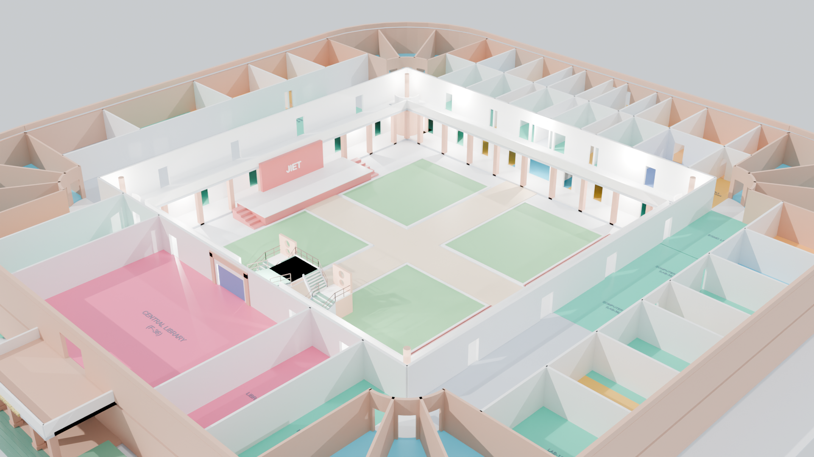
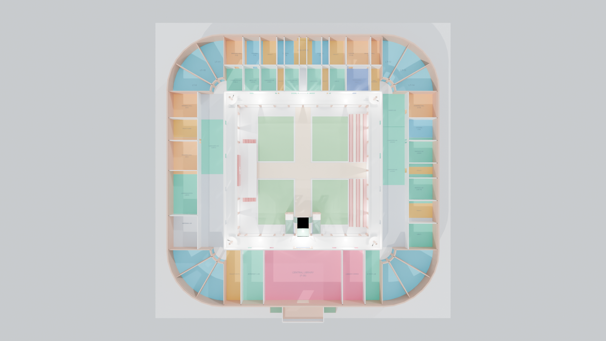
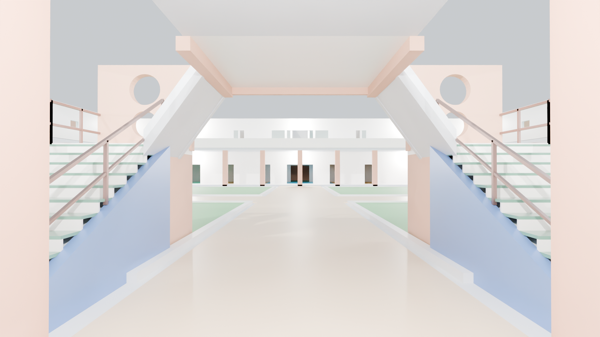
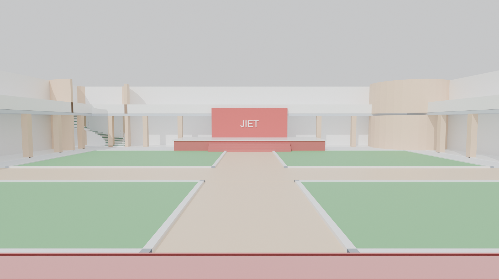
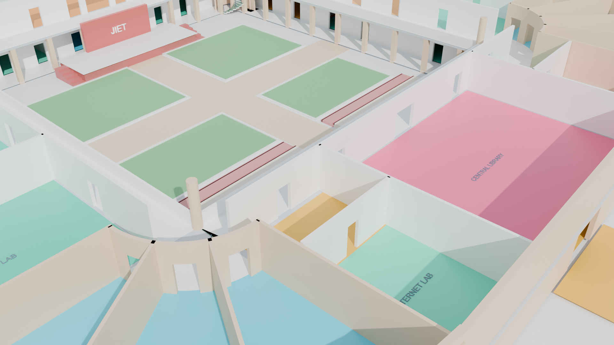
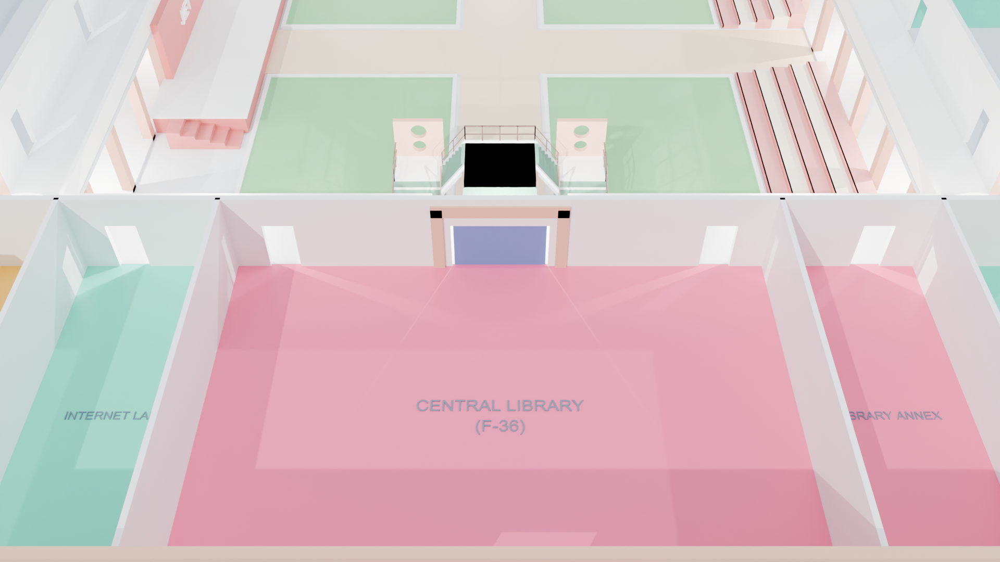
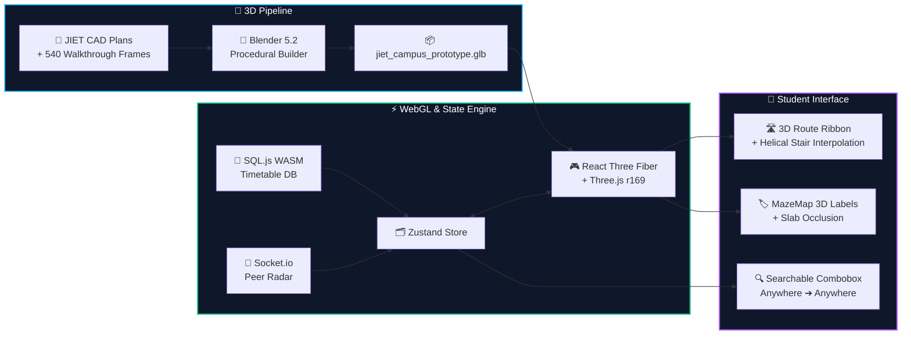
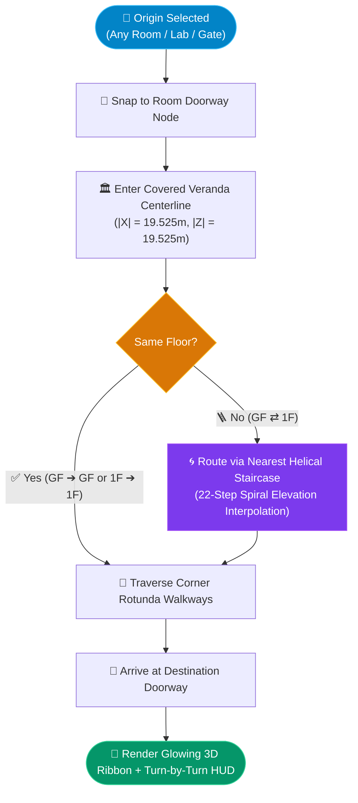
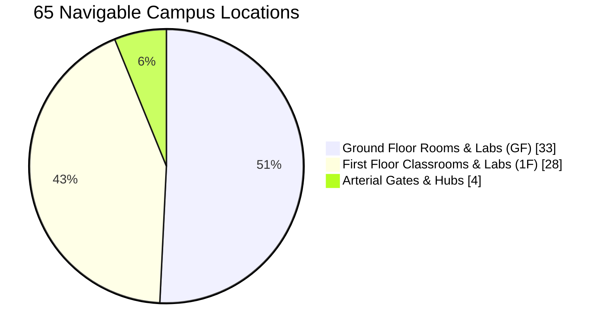

<div align="center">

# 🏛️ UNIPATH — JIET Jodhpur 3D Digital Twin

### *Interactive 3D Campus Map • Turn-by-Turn Indoor Wayfinding • Smart Timetable • Live Peer Radar*

[](https://campusroomfinder.vercel.app)
[](#%EF%B8%8F-quick-start--commands)
[](#-3d-architectural-gallery)

<p align="center">
  
</p>



</div>

---

## 📊 Campus Twin at a Glance

<div align="center">

| 🏫 **61 + 4** | 🧭 **3,721** | 🪜 **6** | ⚡ **359 / 359** |
| :---: | :---: | :---: | :---: |
| **Rooms, Labs & Gates**<br/><sub>33 Ground • 28 First • 4 Hubs</sub> | **Verified Route Pairs**<br/><sub>$61 \times 61$ Collision-Free Paths</sub> | **3D Staircase Transitions**<br/><sub>4 Corner Helical + 2 Library</sub> | **Automated Tests**<br/><sub>Unit • Integration • Stress</sub> |

</div>

---

## 🖼️ 3D Architectural Gallery

<table>
  <tr>
    <td width="50%" align="center">
      
      <br /><b>🌐 3D Isometric Digital Twin</b><br /><sub>Full two-story quadrangle, central lawn & sandstone colonnades</sub>
    </td>
    <td width="50%" align="center">
      
      <br /><b>🗺️ 2D Top-Down Blueprint Mode</b><br /><sub>Color-coded Lecture Theaters, Labs, Library & Admin wings</sub>
    </td>
  </tr>
  <tr>
    <td width="50%" align="center">
      
      <br /><b>🪜 Twin Central Library Staircases</b><br /><sub>Porthole landings & elevated bridge into Central Library (F-36)</sub>
    </td>
    <td width="50%" align="center">
      
      <br /><b>🎭 Central Quadrangle & JIET Stage</b><br /><sub>Cross-walkways, amphitheater bleachers & covered verandas</sub>
    </td>
  </tr>
  <tr>
    <td width="50%" align="center">
      
      <br /><b>🟣 First Floor (1F) Cutaway</b><br /><sub>28 Upper-level LTs, Computer Labs & HOD cabins</sub>
    </td>
    <td width="50%" align="center">
      
      <br /><b>🟢 Ground Floor (GF) Cutaway</b><br /><sub>33 Ground-level Labs, Idea Lab, Drawing Halls & Admin</sub>
    </td>
  </tr>
</table>

---

## 🧠 How It Works (Visual Architecture)

### 1. System Pipeline



### 2. Topological "Anywhere-to-Anywhere" Routing Engine



### 3. Spatial Distribution Across Campus



---

## ⚡ Feature Matrix

| Module | What It Does | Visual Highlight |
| :--- | :--- | :--- |
| **🧭 Anywhere ➔ Anywhere** | Route from **any** room/lab/gate to **any** destination in 1 tap | Glowing floor-grounded 3D ribbon + animated chevrons |
| **🔍 Smart Combobox** | Type-to-search (`LT-9`, `Idea`, `Chem`) + categorized dropdown | Grouped by **Landmarks**, **GF (33)**, and **1F (28)** |
| **🏢 Z-Level Switcher** | Switch between `1F`, `GF`, and `ALL` + `2D` / `3D` camera views | Instant slab isolation & top-down blueprint snap |
| **🏷️ 3D Hovering POIs** | Floating room codes & amenity badges (WC, Stairs, Labs, Library) | Automatic floor-slab occlusion (zero bleed-through) |
| **📅 Timetable Sync** | Detects active class from SQLite schedule & highlights room | 1-tap **"Take Me To Class"** instant routing |
| **👥 Live Peer Radar** | Real-time Socket.io check-ins showing classmates on campus | Live 3D avatars hovering over active rooms |
| **🚀 Anti-Gravity Mode** | Type Konami Code (`↑ ↑ ↓ ↓ ← → ← → B A`) | Zero-G floating physics + cosmic starfield |

---

## 🗺️ Repository Blueprint

```text
campus-room-finder/
├── 🧊 blender/
│   ├── jiet_campus_prototype.blend      # Master Blender 5.2 CAD twin
│   └── renders/                         # 22 Cycles architectural renders
├── 📦 public/models/
│   └── jiet_campus_prototype.glb        # WebGL-optimized 3D campus model
├── ⚛️ src/
│   ├── components/canvas/               # 3D WebGL Scene, Ribbon, Stairs & POIs
│   ├── components/ui/                   # Wayfinding HUD, Combobox, Floor Dock
│   ├── data/                            # 61 rooms + topological waypoint graph
│   ├── services/                        # A* pathfinding, SQL.js & Socket.io
│   └── stores/                          # Zustand state (Campus, Theme, Peers)
└── 🧪 tests/                            # 36 test suites (359 automated checks)
```

---

## 🛠️ Quick Start & Commands

```bash
# 1. Clone & install
git clone https://github.com/yoursexybhavya/campus-room-finder.git
cd campus-room-finder && npm install

# 2. Launch 3D dev server (http://localhost:3000)
npm run dev

# 3. Run all 359 automated tests
npm test

# 4. Build & deploy to production
npm run build && npx vercel --prod --yes
```

---

## 👥 Core Team — The 4 Musketeers

<div align="center">

| <a href="https://github.com/yoursexybhavya"><br/><b>Bhavya Jangid</b></a> | <a href="https://github.com/babooshki"><br/><b>Babooshki</b></a> | <a href="https://github.com/Aditya69-xr"><br/><b>Aditya Jain</b></a> | <a href="https://github.com/Dev-Harry-Code"><br/><b>Harshal Sharma</b></a> |
| :---: | :---: | :---: | :---: |
| [](https://github.com/yoursexybhavya) | [](https://github.com/babooshki) | [](https://github.com/Aditya69-xr) | [](https://github.com/Dev-Harry-Code) |
| <sub>Jodhpur, India</sub> | <sub>Jodhpur, India</sub> | <sub>Jodhpur, India</sub> | <sub>Jodhpur, India</sub> |

</div>

---

<div align="center">

> 📌 **Auto-Sync Rule**: *This `README.md` is continuously updated alongside every architectural, UI, or routing update.*

**Built with ❤️ at JIET Jodhpur • [Live App](https://campusroomfinder.vercel.app)**

</div>
